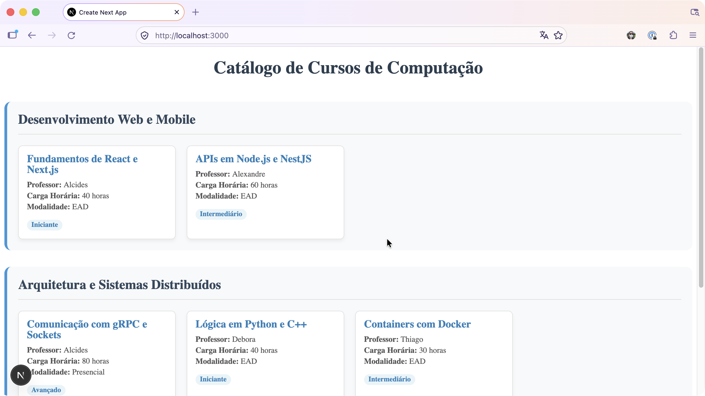

# mackenzie-web-mobile-catalogo-cursos

Atividade desenvolvida na aula de Web Mobile, como requisito para compensação de faltas no regime especial de frequência.

Detalhes disponíveis no arquivo [docs/atividade-guiada.pdf](docs/atividade-guiada.pdf).

## Primeiros Passos

Execute o servidor de desenvolvimento:

```bash
npm run dev
# or
yarn dev
# or
pnpm dev
# or
bun dev
```

Abra [http://localhost:3000](http://localhost:3000) com seu navegador para ver o resultado.

## Captura de Tela


